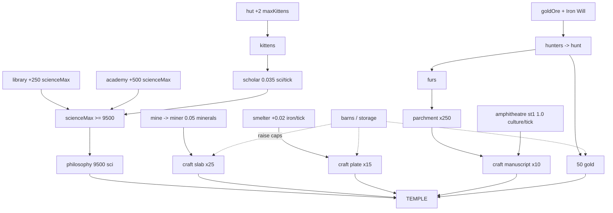

# Temple Recipe — a build order you can follow by hand

**Goal:** build the **Temple** as early as possible.
**Temple costs:** `50 gold · 25 slab · 15 plate · 10 manuscript`.
**Unlocked by:** the tech **philosophy** (9500 science). Two other routes exist
(theology, or a ziggurat) — both need the late tech tree and are far slower.

Every number below is extracted from the game's own data, not estimated:
`solver/catalog/GRAPH.md` (buildings/jobs/resources/upgrades) and
`solver/catalog/RULES.md` (population, jobs, production). Both cite `file:line`
in the game's source.

---

## Read this first — five rules that decide everything

| # | Rule | Consequence |
|---|---|---|
| 1 | **`MaxKittens` starts at 0** (`Game.Effects.fs:78-95`). Nothing is born until you have housing. | **The hut is the first thing you buy.** Hut = `maxKittens +2`. |
| 2 | Every kitten eats **0.85 catnip/tick** (`village.js:9,815`). Starvation is `catnip + perTick < 0` — strictly negative, **1 death per 25 ticks**, youngest die first (`Game.Managers.fs:789-796`). | Catnip is a **hard constraint**, not a nice-to-have. Watch it every single tick. |
| 3 | A kitten is born every **100 ticks = 10 game days** (rate `0.01/tick`, `Program.fs:1805`). | Time is measured in ticks. **1 day = 10 ticks, 1 season = 1000, 1 year = 4000.** |
| 4 | **Gold has no production rate.** It only comes from hunting, and only while **Iron Will is on AND `goldOre` is researched** (`Game.Village.fs:62`). Iron Will is **on by default** (`game.js:2343`), and building a hut/mansion/logHouse turns it **off** (`KittensState.fs:678`). | Hunt gold early, and re-enable Iron Will before the final push. |
| 5 | Base storage caps are tiny: **gold 10, iron 50, minerals 250, wood 200** (`Game.Catalog.BaseEffects.fs:13-19`). | You cannot even *hold* the temple materials until you upgrade barns/warehouses. |

> The old solver failed on rule 4 and rule 5 together: it produced **0 gold in
> 150 game-years** and never discovered that huts switch Iron Will off.

---

## The four resource trains

| Temple input | Needs | Produced by | Rate |
|---|---|---|---|
| **50 gold** | hunting | hunters → `huntall` | ≈0.3125 gold/hunter/hunt (see below) |
| **25 slab** | 6250 minerals | miners (`0.05/tick` each) × `mineralsRatio` | mine +20 %, quarry +35 % |
| **15 plate** | 1875 iron | smelters (`ironPerTickAutoprod 0.02/tick` each) | smelter also eats 0.1 minerals + 0.05 wood/tick |
| **10 manuscript** | 4000 culture **+** 250 parchment | amphitheatre + hunters | parchment = **175 furs each** |

**Plus the science track:** philosophy costs **9500 science**, and science is
capped at `scienceMax = min(compedium × 10, Σ building scienceMax)` (`Game.Managers.fs:341-343`).
So you need **scienceMax ≥ 9500** *before* you can bank it:
- **library** → +250 scienceMax, +0.1 scienceRatio, costs `25 wood × 1.15ⁿ`
- **academy** → **+500** scienceMax, **+0.2** scienceRatio, costs `50 wood + 70 minerals + 100 science`, needs **math**

→ **38 libraries**, or **19 academies**, or a mix. *This is the long pole.*

---

## Hunting — the engine behind gold, furs and ivory

```
manpowerCost = 100 − huntCatpowerDiscount          (Game.Village.fs:87)
squads       = floor(floor(manpower / 100) / 1)   (Game.Village.fs:88-90)

furs         = 80·IH(squads)          + 65·hunterRatio·IH(squads)
gold         = 5·IH(goldHunts)       + 5·hunterRatio·IH(goldHunts)   ← ONLY if IronWill && goldOre
              where goldHunts = binominal(rand, squads, 0.25)
```
`IH(n)` is a sum of `n` uniform[0,1] draws, so **E[IH(n)] = n/2**.
Each hunter regenerates **0.06 manpower/tick** (`village.js:60-62`).

Worked out at `hunterRatio = 1`:

| Per | Value |
|---|---|
| furs | `10·hunters + 8.125·hunters` = **18.1 furs per hunter per hunt** |
| gold | **0.3125 gold per hunter per hunt** |
| one hunt costs | **100 manpower**, i.e. `1667 / hunters` ticks to refill |

→ **20 hunters ≈ 1.87 furs/tick and 0.0625 gold/tick.** 50 gold arrives in
roughly 800 ticks of hunting once you have hunters and Iron Will up.
The 43,750 furs the manuscripts need is the *real* hunter workload.

---

## The build order

Each phase lists what to **do**, what it **costs**, and **how to check it worked**.
Times are estimates at the stated worker counts — the point is the order and
the ratios, not the exact tick.

### Phase 0 — survive and unlock (tick 0 → ~200)

- [ ] Click **Gather catnip** continuously. Catnip is the only early input.
- [ ] **Craft wood** whenever you can: `100 catnip → 1 wood`.
- [ ] **Buy Hut** as soon as you have 5 wood. → `maxKittens = 2`.
- [ ] Keep buying **Hut** whenever `wood ≥ 5 × 2.5ⁿ`. Two kittens sleep in one hut.
- [ ] Keep **Gather**-ing. Never let catnip hit 0 once you have kittens.

> **Check:** kitten count rises by 1 every 100 ticks. If it does not, you are
> either at `maxKittens` (build a hut) or starving (raise farmers/fields).

### Phase 1 — the food engine (the part that kills runs)

Catnip in = `1.0 × farmers + 0.125 × fields`, all × `(1 + catnipRatio)`.
Catnip out = `0.85 × kittens`.

- [ ] Research **agriculture** (100 science) → unlocks the **farmer** job.
- [ ] Assign **1 farmer per kitten**, then add **fields** as headroom.
      20 fields = `2.5 catnip/tick` ≈ 3 kittens on their own.
- [ ] **A farmer is the cheapest catnip you will ever buy** (1.0/tick for one
      kitten). Fields are the scalable part.
- [ ] Before adding *any* kitten, check the arithmetic:
      `1.0·farmers + 0.125·fields > 0.85 × kittens`.

> **Check:** catnip per tick in the resource bar must stay **positive**. If it
> goes negative you will lose one kitten every 25 ticks, youngest first, and
> births stop that same tick.

### Phase 2 — science spine

- [ ] Buy **Library** (25 wood) whenever wood allows. It unlocks the **scholar**.
- [ ] Assign **scholars** — `0.035 science/tick` each, ×`(1 + scienceRatio)`.
- [ ] Research in this order — it is the cheapest path to philosophy:
      `calendar → agriculture → archery → animal → construction → engineering → writing → philosophy`
- [ ] **Mine** (100 wood, needs **mining**) → unlocks **miner**.
- [ ] **Smelter** (200 minerals, needs **metal**) → `+0.02 iron/tick`.
- [ ] **Academy** (needs **math**) once you can pay 100 science: it is *twice* the
      scienceMax of a library and doubles the scienceRatio.

> **Check:** you need **scienceMax ≥ 9500** before philosophy is bankable.
> Count `250 × libraries + 500 × academies`. At 29 libraries you stall at
> 7500 — this is exactly where the old solver died.

### Phase 3 — the gold run (do this EARLY, while Iron Will is still on)

- [ ] Research **goldOre** — `800 minerals + 100 iron + 1000 science`.
      (It has no effect of its own; it *gates* hunting gold.)
- [ ] Assign **hunters** (needs **archery**). They make 0.06 manpower/tick each.
- [ ] **Hunt** whenever manpower ≥ 100. Bank gold.
- [ ] **Do not build more huts during the gold run** — every hut sets
      `IronWill = false` (`KittensState.fs:678`) and hunting gold stops instantly.
- [ ] Once you have **50 gold**, you are allowed to forget about it.

> **Check:** gold must actually move when you hunt. If it does not, either
> Iron Will is off (you built a hut) or `goldOre` is not researched.

### Phase 4 — storage (do not skip; you will silently waste everything)

| Need | Base cap | Fix |
|---|---|---|
| hold 50 gold | **10** | barn stage upgrades / `register` (10 gold + 500 science) / later storage |
| hold 6250 minerals | **250** | barns (50 wood, needs agriculture), then warehouses |
| hold 1875 iron | **50** | barns + warehouse chain |
| hold wood | **200** | barns |

- [ ] Build **barns** whenever wood ≥ 80 % of cap.
- [ ] Craft slabs **continuously** — never let minerals sit at the cap.

### Phase 5 — the four materials

- [ ] **Slabs:** `250 minerals → 1 slab`, ×25. Feed it with miners + quarry.
- [ ] **Plates:** `125 iron → 1 plate`, ×15. Smelters are the iron source;
      more smelters = linearly faster, but each eats 0.1 minerals + 0.05 wood/tick.
- [ ] **Manuscripts:** `400 culture + 25 parchment`, ×10.
      - **Amphitheatre stage 1** = `1250 iron + 75 titanium` → **1.0 culture/tick**
        (stage 0 only gives 0.005 — 200× worse). This is why plates are early.
      - **Parchment** = `175 furs` each; 250 of them = **43,750 furs**.
        Budget hunter time for this — it is the longest single train.

### Phase 6 — build the Temple

- [ ] Bank 9500 science → **research philosophy** → temple unlocks.
- [ ] Have in the bank: `50 gold · 25 slab · 15 plate · 10 manuscript`.
- [ ] **Build Temple.**

> Temple is worth `+100 faithMax`, `+0.1 culture/tick`, and is the gateway to
> religion (`priest`, chapels, ziggurat).

---

## The dependency picture



Full machine version: `solver/catalog/DEPS.mmd` · full prerequisite closure
with reasons: `solver/catalog/GRAPH.md`.

---

## How to check this recipe against the real game

The port reproduces the original bit-for-bit, so this recipe is *testable*, not
just plausible. To verify a step:

1. Write the steps as a scenario (`oracle/scenarios/*.cat` format —
   `<tick> <action>` lines plus a seed and checkpoints).
2. Run it through **both** drivers:
   ```
   cd multistep_port/oracle/runner
   node orig-driver.js ../scenarios/mine.cat out-orig.json
   dotnet run --project fs-runner -- ../scenarios/mine.cat out-fs.json
   node ../../tools/diff-snapshots.js out-orig.json out-fs.json
   ```
3. `IDENTICAL: N checkpoints` means the plan is real: the original game, run
   headless, produces exactly this state.

That is the bar every future solver plan must clear before it gets called a
strategy.